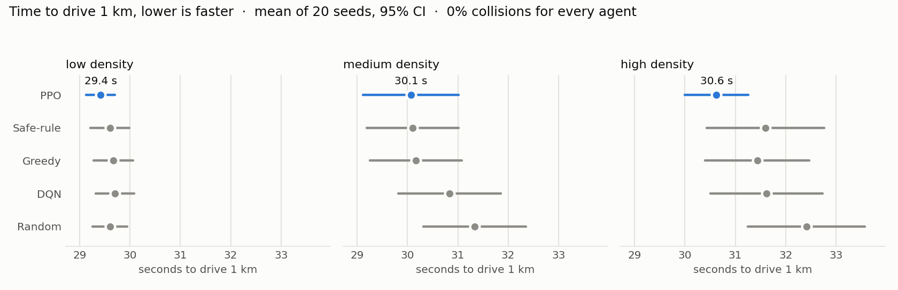

# LaneIQ

> **RL agents that learn to drive a highway — trained from scratch,
> evaluated over 20 seeds per scenario, and streamed live to a browser.**

<!--
  HERO GIF — drop the recording here.
  Record the 30-second cut from docs/demo_storyboard.md, export to
  docs/images/demo.gif (keep it under ~8 MB, ~12 fps), and the line
  below will render it. Until then it shows a broken-image placeholder
  — that's expected pre-recording.
-->


End-to-end reinforcement learning for highway lane optimization in
[SUMO](https://eclipse.dev/sumo/), with a live React + FastAPI
dashboard streaming a trained agent's decisions in real time.

A SUMO 3-lane highway populated with Poisson background traffic at
three density levels. The ego vehicle is controlled by an RL agent
that picks one of `STAY` / `CHANGE_LEFT` / `CHANGE_RIGHT` every 100 ms
to maximize a 6-component reward trading off speed, safety, and
stability.

**Three RL families compared:**

- **DQN** — implemented from scratch in PyTorch (replay buffer, target
  network, ε-greedy, Double DQN, Huber loss)
- **PPO** — via [`sb3-contrib`](https://github.com/Stable-Baselines3/stable-baselines3-contrib) `MaskablePPO`
- **Multi-agent parameter-sharing PPO** over a PettingZoo
  `ParallelEnv` (4 cooperating egos in one scene)

A live dashboard renders the SUMO state in real time — top-down
Canvas2D road with snapshot interpolation, AI decision narration,
per-step reward breakdown — and supports both live SUMO playback and
pre-recorded JSON replays through the same WebSocket path.

## Headline numbers

20 seeds × 3 traffic densities per agent. With a lane-change assist
(SUMO's safety check) **every agent is collision-free at every
density**, so the comparison is how fast each one gets through traffic.
**On high density PPO drives 1 km about 1 s faster than the rule-based
agents** (paired over the same 20 seeds). At low and medium density the
field is effectively tied, because most seeds finish in identical time
behind the same traffic.



*Mean finish time with 95% confidence intervals; PPO highlighted. The
intervals overlap at low and medium density.*

| Agent | Finish time L / M / H (s) | Mean speed L / M / H (m/s) | Lane changes/min L / M / H | Gauntlet finish (s) |
| --- | --- | --- | --- | --- |
| `random` | 29.6 / 31.3 / 32.4 | 33.8 / 32.0 / 31.0 | 29.3 / 15.9 / 12.3 | 30.6 |
| `greedy` | 29.7 / 30.2 / 31.4 | 33.7 / 33.3 / 31.9 | 2.2 / 4.2 / 5.1 | 30.4 |
| `safe_rule` | 29.6 / 30.1 / 31.6 | 33.8 / 33.3 / 31.8 | 0.6 / 1.4 / 1.5 | 30.6 |
| DQN (`dqn_v4_mixed_200k_obsfix`) | 29.7 / 30.8 / 31.6 | 33.7 / 32.5 / 31.7 | 3.2 / 3.2 / 2.9 | 30.6 |
| **PPO (`ppo_v12_safety_cd_150k`; gauntlet `ppo_v10_gauntlet_cd_300k`)** | **29.4 / 30.1 / 30.6** | 34.0 / 33.4 / 32.7 | 2.4 / 3.0 / 3.6 | 30.5 |

Collisions: **0% for every agent at every density.** Paired same-seed
differences vs PPO on high density: `greedy` +0.81 s [95% CI +0.16,
+1.46], `safe_rule` +0.97 s [+0.14, +1.81], `random` +1.79 s [+0.83,
+2.75]; vs DQN it's borderline (+1.00 s [−0.04, +2.03]). Multi-agent
(`mappo_v3_coop_cd_300k`, 4 egos sharing one policy): 0% per-ego
collisions. The rule-based "Aggressive" demo agent averages 42.4 m/s
through 33 m/s traffic with 0/5 collisions.

## How we got here — the honest version

An earlier version of this README said the safety-tuned PPO was "the
only policy with 0% collisions everywhere". That was true of the
numbers and false about the driving. Getting to the table above meant
finding and fixing four problems, each hiding behind the last:

1. **A perception bug.** The side-lane observations had TraCI's
   left/right bits swapped, so every agent saw mirrored or empty
   adjacent lanes. The "never crashes" PPO had simply learned to stay
   in its lane. A unit-test mock had copied the same wrong table, so
   the tests agreed with the bug; a ground-truth SUMO test now guards it.
2. **Dithering.** With correct inputs, retrained agents changed lanes
   back and forth for tiny gains: a lane change cost 0.05 against up to
   1.0 of speed reward per step. A 1.5 s lane-change cooldown, exposed
   in the observation so even unmasked MAPPO can see it, plus a 20×
   lane-change cost fixed that.
3. **An unchecked controller.** Every remaining crash was the simulator
   executing a requested lane change into a car directly alongside.
   Lane-change mode 0 tells SUMO to execute requests unchecked. Measured
   directly, modes 0 and 1024 crash and 256/512/768 refuse. Mode 768
   (respect others' gaps, no speed adaptation) is now the default, like
   a car's lane-change assist: the policy still decides when and where.
4. **A reward that couldn't see speed.** Episodes are a fixed 1 km, so
   a per-step speed term sums to the same total for every driver. Return
   doesn't measure driving quality here, so agents are ranked by finish
   time. The ego's speed factor was also randomly sampled per seed (it
   reached 50 m/s on a 36 m/s road) and is now pinned.

A per-step time penalty was tried as a fix for (4) and **made PPO
slower** (33.1 s vs 30.6 s on high density). The safety penalty for
close following outweighed the time saved by passing, so those
checkpoints were not promoted. Full write-up:
[docs/results.md](docs/results.md).

## Documentation

The `docs/` tree is the public-facing documentation:

| Page | What it covers |
| --- | --- |
| [docs/architecture.md](docs/architecture.md) | System layers: SUMO scenario → Gym env → agents → eval → live demo |
| [docs/rl_design.md](docs/rl_design.md) | Observation / action / reward design + algorithm walkthroughs |
| [docs/results.md](docs/results.md) | Current 20-seed results, the four fixes behind them, and the earlier results they replaced |
| [docs/quickstart.md](docs/quickstart.md) | Install + run + train + re-eval, ~10 min from clone |

## Quickstart

```bash
git clone https://github.com/rzarka1298/Lane-Optimize.git
cd Lane-Optimize
make install                              # uv sync; ~3-5 min on a fresh machine
make test                                 # 190 fast tests, a few seconds

# In one terminal — backend:
uv run uvicorn backend.app.main:app --reload --port 8000

# In another terminal — frontend:
cd frontend && npm install && npm run dev
# → open http://localhost:5173
```

Apple Silicon is the primary supported platform; x86_64 Linux works
too. No separate SUMO install needed — the `eclipse-sumo` PyPI wheel
ships the full toolchain inside `.venv/bin/`.

Full instructions in [docs/quickstart.md](docs/quickstart.md).

## Repo layout

```
laneiq/                Main Python package
  env/                 Gymnasium env wrapping SUMO via TraCI
  agents/dqn/          From-scratch DQN (network, replay, agent, train)
  agents/baselines/    Rule-based comparison agents + the demo overtaker
  agents/ppo_sb3.py    SB3 MaskablePPO wrapper (Policy protocol)
  eval/                Reproducible evaluation matrix
sumo_scenarios/        Hand-authored 3-lane highway scenario (XML)
backend/               FastAPI live-demo server (TraCI + WebSocket)
frontend/              Vite + React + TS dashboard
scripts/               CLI entrypoints (training, sweeping, plotting, recording)
checkpoints/final/     Promoted checkpoints (current + earlier, for comparison)
results/               Eval CSVs + replay JSONs
docs/                  Public-facing documentation
```

## What's where

| File | Purpose |
| --- | --- |
| `Makefile` | Convenience targets: `install`, `test`, `lint`, `train-dqn`, `train-ppo`, `eval`, `sumo-gui-{low,medium,high}` |
| `pyproject.toml` | Python deps + extras (`sumo`, `rl`, `multiagent`, `dev`) |
| `frontend/package.json` | React + Vite + Tailwind + Recharts |
| `Lane-Optimize-PRD.pdf` | Original product requirements |
| `CLAUDE.md` | Project instructions used during development |

## Tests

```bash
make test                    # 190 fast tests; a few seconds
uv run pytest                # all 219 tests including @sumo-marked slow tests; ~1-2 min
make lint                    # ruff
cd frontend && npm run lint  # tsc --noEmit
```

Coverage spans every layer: SUMO runtime lifecycle, observation
builder (including a ground-truth side-lane test against real SUMO),
action handling and the lane-change cooldown, lane-change safety
modes, reward composer, env, mixed-density wrapper, multi-agent env,
baselines, DQN (network/replay/agent/trainer), PPO wrapper, eval
framework (metrics/runner/compare), backend (endpoint + schema tests).

## Status

✅ Done: SUMO scenario, env, baselines, DQN-from-scratch, PPO, MAPPO,
20-seed eval matrix, FastAPI backend with replay mode, React dashboard
with smooth playback, the perception / dithering / controller / reward
fixes above.

⏳ Open: demo GIF recording; rebalancing the unsafe-gap penalty against
a time or progress term so that rewarding speed actually makes the
learned agents faster.

## License

MIT
