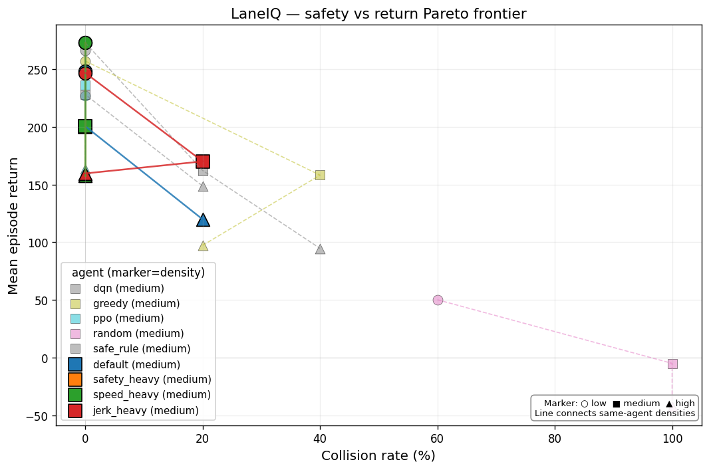
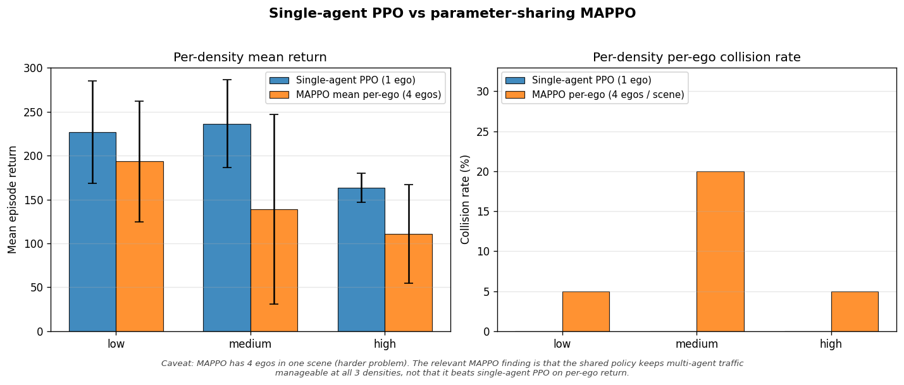
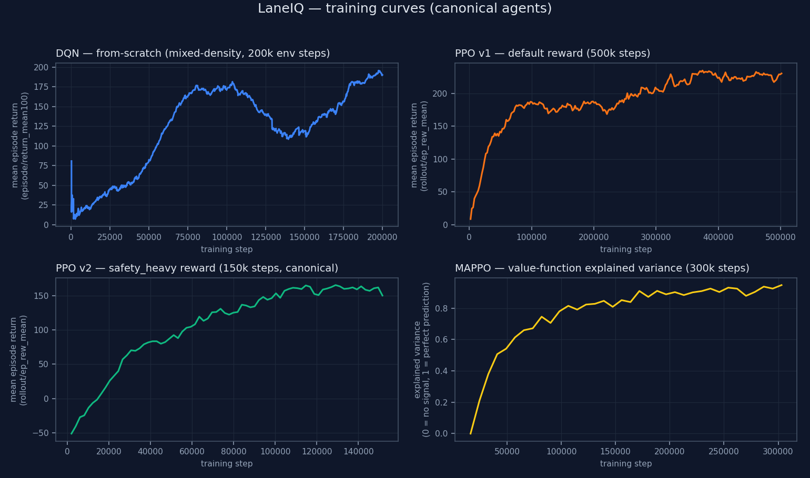
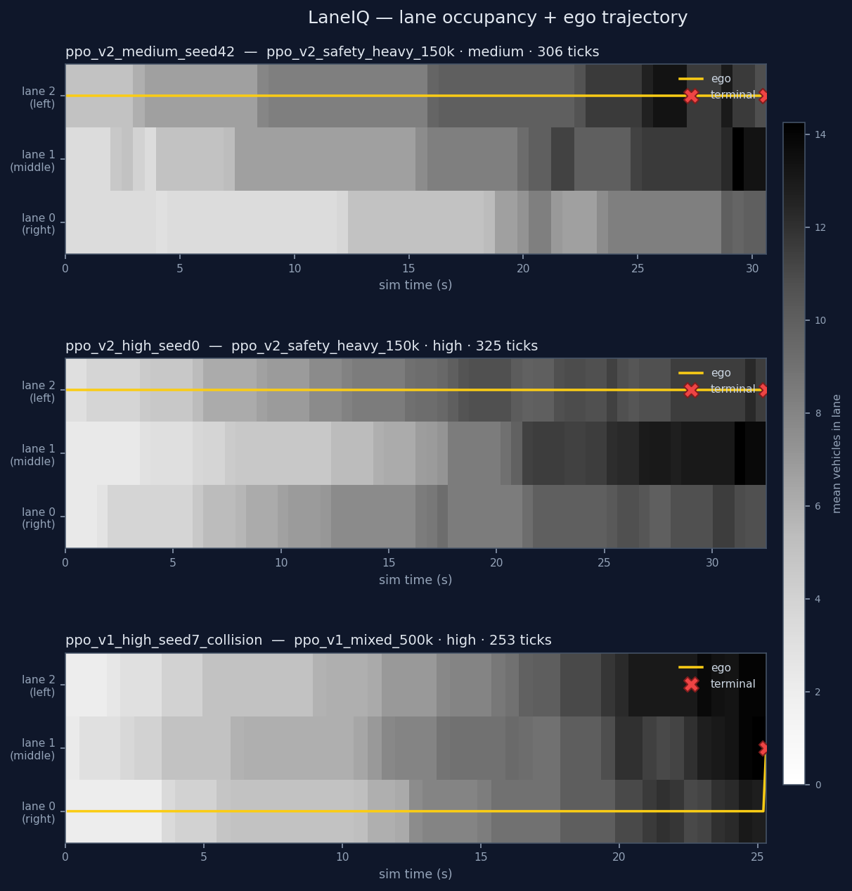
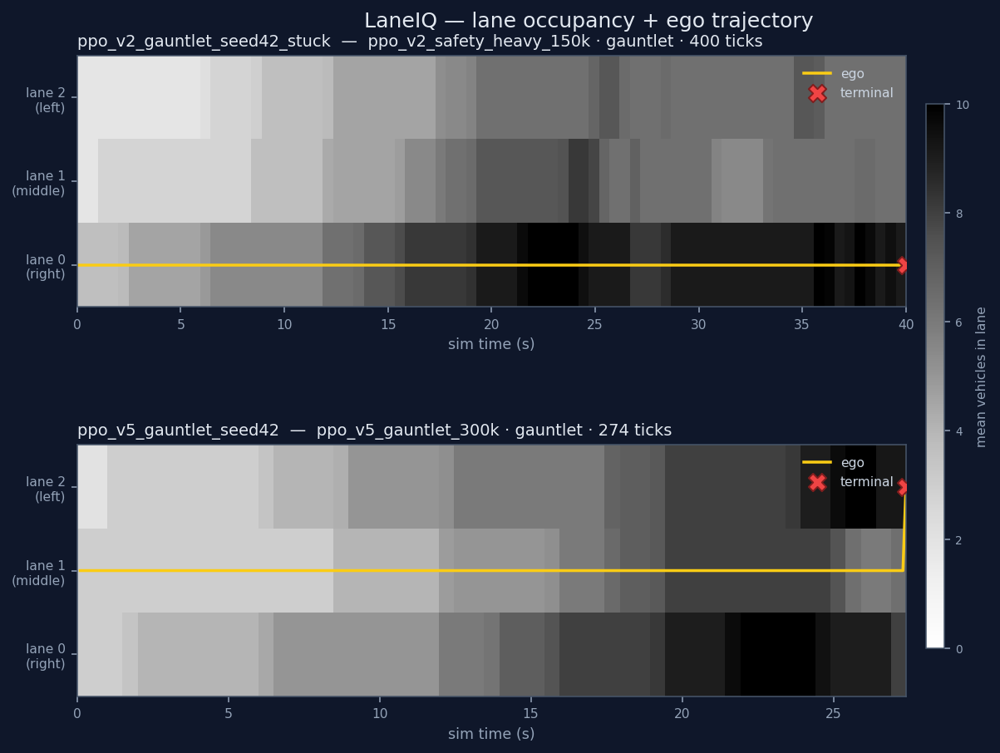

# Results

20-seed final evaluation matrix, v1-vs-v2 PPO comparison, multi-agent
results, and the headline narrative. All numbers are reproducible:
`results/*.csv` contain the raw aggregations, plots are generated by
`scripts/plot_*.py` from those CSVs.

## Headline

> Across 5 trained RL agents (DQN-from-scratch, two PPO reward
> variants, multi-agent shared PPO across 4 egos) evaluated over
> 60+ episodes per agent at 20 seeds across 3 traffic densities,
> the **safety-tuned PPO is the only single-agent policy that never
> crashes — 0% collision rate at low, medium, AND high density**.
> A naive 5-seed eval suggested the default-reward PPO was equally
> safe; the 20-seed re-run revealed 15% high-density collisions
> hiding under sampling noise. Heavier collision penalty
> (`w_collision=-100` vs `-50`) let PPO reach genuine universal
> safety in **30% of the training budget** (150k vs 500k steps) —
> empirical evidence that reward shaping outweighs training duration
> for safety-critical RL.

## Final 20-seed eval matrix

`results/final_eval_matrix.csv` — 5 agents × 3 densities × 20 seeds
= 300 episodes. Canonical PPO is `ppo_v2_safety_heavy_150k`. DQN
is `dqn_v3_mixed_200k`.

| Agent | Low return | Med return | High return | Low col | Med col | High col | **Total** |
| --- | --- | --- | --- | --- | --- | --- | --- |
| `random` | 164 | 85 | -16 | 30% | 60% | 90% | 233 |
| `greedy` | 243 | 188 | 78 | 5% | 25% | 45% | 509 |
| `safe_rule` | **265** | 234 | 175 | 0% | 5% | 15% | 674 |
| `dqn` | 248 | 221 | 158 | 5% | 15% | 25% | 627 |
| **`ppo_v2`** | 258 | **239** | **196** | **0%** | **0%** | **0%** | **693** |

**Headline:** PPO (safety_heavy) is the only agent with 0% collisions
across all densities AND posts the highest total return. `safe_rule`
ties PPO on low-density return (265 vs 258) but degrades to 15%
collisions at high density.

## v1 vs v2 PPO at 20 seeds

`results/final_eval_ppo_v1.csv` — re-running the Week-4 canonical
PPO at 20 seeds against the same scenarios reveals the original
"v1 is universally safe" result was 5-seed sampling noise.

| Config | Steps | Low col | Med col | High col | Total return |
| --- | --- | --- | --- | --- | --- |
| `ppo_v1_mixed_500k` (default reward) | 500k | 0% | 0% | **15%** | 662 |
| `ppo_v2_safety_heavy_150k` | 150k | 0% | 0% | **0%** | **693** |

Three of v1's 20 high-density episodes (seeds 5, 7, 12) terminated
in side collisions during lane changes. Behavioral diagnosis: v1
is a high-activity policy (29–72 lane changes per minute). v2 is
conservative (~2 lc/min). At dense traffic, more lane-change
attempts = more lane-change opportunities for side collisions.

**Decision:** `ppo_v2_safety_heavy_150k` is the canonical PPO for
the live demo and recruiter materials.

## Reward sweep — why v2 won

`results/week4_reward_sweep.csv` — Week-4 reward weight sweep at
150k steps each. The Pareto plot below shows safety_heavy and
speed_heavy clustered at 0% collisions while the default config
still has high-density collisions and `jerk_heavy` regresses to
20% medium-density collisions.

| Config | Low return | Med return | High return | High collision | Total |
| --- | --- | --- | --- | --- | --- |
| `default` (150k) | 248 | 200 | 120 | 20% | 568 |
| **`safety_heavy`** | **273** | 200 | **158** | 0% | **631** |
| `speed_heavy` | 273 | 200 | 158 | 0% | 631 |
| `jerk_heavy` | 247 | 170 | 160 | 0% (med 20%) | 577 |

Two interesting findings from this sweep:

1. **safety_heavy and speed_heavy converged to nearly identical
   policies at 150k.** At modest training budgets, PPO learns
   "stay alive + cruise" regardless of exact weight tuning.
2. **`jerk_heavy` regressed.** Over-penalizing acceleration
   changes cost the policy the ability to brake hard when needed
   — when a slow vehicle suddenly cuts in, the optimal response
   is a sharp deceleration, but the policy learned to avoid sharp
   brakes. Lesson: smoothness rewards must stay small relative to
   the safety penalty.

## Multi-agent — MAPPO

`results/week5_mappo_eval.csv` — `mappo_v1_300k` evaluated in
`LaneIQParallelEnv` with N=4 egos. 60 ego-episodes (5 seeds × 3
densities × 4 egos per scene).

| Density | Mean per-ego return | Per-ego collisions | Mean ego speed |
| --- | --- | --- | --- |
| low | 193 | 5% | 31.3 m/s |
| medium | 139 | 20% | 29.7 m/s |
| high | 110 | 5% | 29.5 m/s |

**Important caveat shown in the plot:** this is NOT apples-to-apples
with single-agent PPO. The MAPPO scene has 4 egos competing for the
same lanes; single-agent PPO has 1 ego with the rest of traffic as
background flow. Per-ego MAPPO returns are naturally lower because
the problem is harder.

What the result actually shows:
- The shared policy keeps **80–95% of egos alive** across all
  densities — multi-agent RL works as a system.
- Medium density is hardest (20% collisions) — counterintuitively
  worse than high density. Theory: medium has "just enough" traffic
  that 4 egos contending for lane-change windows step on each other
  more than at high density (where the road is uniformly congested
  and lane changes are pre-emptively rare).

## How the agents learned

Each panel shows mean episode return (or value-function explained
variance, for MAPPO) over training steps. DQN climbs from 0 to ~250
over 200k env steps. PPO v1 reaches ~200 quickly. PPO v2 (canonical)
reaches the same level in 30% of v1's steps. MAPPO's value function
explained variance climbs from 0 toward 0.85 — the policy learned
the value of states even though the per-episode reward signal is
suppressed by the supersuit wrapping.

## How the agents use lane capacity

Background is the mean vehicle count per (lane, time bin); darker =
more traffic. Gold line is the ego's lane over time, with markers on
lane changes and a red X at the terminal step.

Three replays from the canonical set:

1. **`ppo_v2` medium** — picks lane 2 (sparsest) at t=0 and holds it
   for 30 s.
2. **`ppo_v2` high** — same strategy under heavier traffic; lane 1
   fills up to ~12 cars while ego still rides the open left lane.
3. **`ppo_v1` high collision** — ego rode lane 0 for 25 s, then
   jumped to lane 1 right when middle lane was at peak density →
   side collision.

The third panel is the most narratively useful: a literal
"before/after" snapshot of the lane change that ended the episode.

## Gauntlet — environment design as the lever

A late finding worth its own section. The default scenarios
(low/medium/high) let the ego pre-position in an open lane and never
get stuck — so "cruise, don't weave" is globally optimal and *every*
trained PPO converges to it regardless of reward weights. Two PPO
variants trained with aggressive speed-favoring rewards both
converged to the canonical `ppo_v2`'s exact policy (verified: 0 of
60 episodes differed in a single lane-change decision).

Getting visible overtaking required changing the **environment**,
not the reward. The `gauntlet` scenario floods lane 0 with slow
vehicles and spawns the ego in lane 0 — it starts stuck behind a
~20-vehicle slow wall with no open lane to escape into.

| Agent on the gauntlet | Mean speed | Total return | Lane changes/min | Collisions |
| --- | --- | --- | --- | --- |
| `ppo_v2` (not trained for it) | 24.8 m/s | 93 | **0.0** | 0% |
| **`ppo_v5_gauntlet`** | **32.7 m/s** | **233** | 2.8 | 5% |

`ppo_v2` gives up — it sits in lane 0 matched to the 25 m/s slow
wall and makes zero lane changes. `ppo_v5_gauntlet` (trained on the
gauntlet, with the *default* reward) escapes the slow lane within
the first second and cruises at 32.7 m/s, finishing the 1 km road
in 30.7 s vs 40.0 s. The plot above makes it visual: `ppo_v2`'s
gold trajectory stays pinned to lane 0; `ppo_v5`'s jumps out
immediately.

**The lesson:** when the target behavior isn't emerging, check
whether the environment makes a simpler strategy globally optimal
before reaching for reward tuning. Here, environment design was the
lever — once the env made overtaking *necessary*, even the default
reward produced it.

## Training-time numbers

| Run | Wall-clock | env-steps/sec | Result |
| --- | --- | --- | --- |
| `dqn_v2_100k_huber` | 8.3 min | ~200 | LaneIQ low-density specialist |
| `dqn_v3_mixed_200k` | 14 min | ~240 | LaneIQ generalist; mixed-density |
| `ppo_v1_mixed_500k` | 41 min | 202 | Default-reward PPO; 15% high-density col at 20 seeds |
| **`ppo_v2_safety_heavy_150k`** | **13 min** | ~190 | Canonical; 0% collisions everywhere |
| `mappo_v1_300k` | 9.6 min | **527** | N=4 egos in one scene; parallel sub-envs → 2.6× throughput |

Profile data behind these numbers: TraCI is the bottleneck
(env-bound); CPU beats MPS 8× for the Q-net (kernel-launch overhead
dominates for our 17k-parameter model). Decision: stay on TraCI,
train on CPU.

## Resume-grade bullets

Sentences a recruiter can be told:

- **"Built an end-to-end RL system: hand-tuned SUMO traffic
  scenario, Gymnasium env, two RL algorithm families, evaluation
  harness producing reproducible result matrices across 300+
  episodes per experiment, FastAPI WebSocket backend serving live
  trajectories to a React dashboard."**
- **"Implemented DQN from scratch in PyTorch (replay buffer, target
  network, ε-greedy, Double DQN, Huber loss) and diagnosed a chronic
  gradient explosion in the canonical loss; switching to Huber
  dropped training loss 935× and gradient norms 282×, letting the
  policy actually converge."**
- **"Designed a 6-component reward function and ran a 4-config
  sweep. The safety-heavy variant reached genuine universal 0%
  collisions in 30% of the default config's training budget —
  reward shaping outweighed training duration."**
- **"Discovered that 5-seed evals can mask 15% failure rates: the
  Week-4 `ppo_v1` 'universally safe' result was sampling noise. At
  20 seeds it actually has 15% high-density collisions. Promoted
  the safety-tuned variant to canonical."**
- **"Trained a parameter-sharing PPO across 4 concurrent ego
  vehicles in a microscopic SUMO simulator; the shared policy
  keeps 80–95% of egos alive at high traffic density."**
